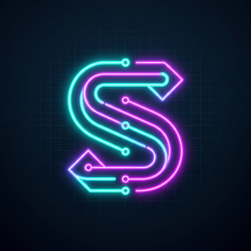

# 🧠 Stroop Route（ストループ・ルート / 意色交差パズル）

<div align="center">


<br />
<br />


**文字の意味とインク色が交差する！脳のギアチェンジを強制する新感覚一筆書きパズル**

[🎮 今すぐオンラインで遊ぶ（本番公開URL）](https://stroop-route.vercel.app)

</div>

---

## 🌟 概要 (Overview)

**Stroop Route（ストループ・ルート）** は、脳科学における「**ストループ効果**（文字の意味とフォントのインク色が干渉して判断が遅れる心理現象）」を一筆書き迷路のルールに統合した脳トレ・Webパズルゲームです。

人間が無意識に文字を読んでしまう「読字の自動化」を逆手に取り、前頭前野の **抑制制御（Inhibitory Control）**、**認知的柔軟性（Cognitive Flexibility）**、**空間ワーキングメモリ（Working Memory）** を楽しみながら鍛えることができます。

スマートフォン（iOS / Android）およびPCブラウザの両方で快適に動作し、**PWA（Progressive Web App）** としてホーム画面に追加すれば、電波の届かないオフライン環境でもネイティブアプリ感覚でプレイ可能です。

---

## 🎮 主な機能・特徴 (Features)

### 1. ストループ干渉 × 一筆書きパズル
- **通常モード**: 直前のマスの**「文字の意味」**と同じ**「インク色」**を持つ隣接マスへ進みます。
- **反転ゲート（⚡）**: ゲートをくぐるとモードが瞬時に反転！直前のマスの**「インク色」**と同じ**「文字の意味」**へ進むルールに切り替わり、脳のギアチェンジが試されます。

### 2. 多言語4表記（ひらがな・カタカナ・漢字・英語）の認知的交差
- 「あか」「アオ」「緑」「BLUE」のように表音文字（カナ）、表意文字（漢字）、英語アルファベットが混在。
- 英語のみのステージ（Stage 6）や4表記すべてが激突するステージ（Stage 7）など、言語野と視覚野の干渉強度が極限まで高まる認知抑制トレーニングを実現。

### 3. 4×4ファインダー × スワイプ展開型広大迷宮（最大10×10）
- スマートフォン画面の視認性を損なわないよう、画面内には常に4×4マスが大きく表示されます。
- 7×7マス（Stage 4）や10×10マス（Stage 5）の広大迷宮では、盤面をスワイプすることで視界窓（ファインダー）が滑らかにスライド展開します。
- CSS Container Query Units（`100cqw`）を採用し、全ステージで画面に見えるマスの大きさやフォントサイズが完全均一です。

### 4. 完全PWA（Progressive Web App）対応
- **ホーム画面への追加**: iOS Safari / Android Chrome からワンタップでインストール可能。
- **高解像度ネオンアイコン**: ダークサイバー空間に浮かぶ二重ネオン「S」ルートを象徴した専用アプリアイコン（192px, 512px, Maskable, Apple Touch Icon）。
- **オフライン動作**: Service Worker によるキャッシュファースト配信により、地下鉄や飛行機などの圏外環境でも完全オフラインで動作。

### 5. デイリーチャレンジ ＆ Wordle風 SNS絵文字共有
- 毎日日替わりで全世界共通のパズルが出題される「Daily Challenge」。
- クリア時のタイム・歩数・解いた軌跡をWordle風の絵文字テキストでクリップボードにコピーし、X（Twitter）やLINEですぐに共有可能。

### 6. カラーユニバーサルデザイン（CUD）配慮
- 色覚の多様性に配慮し、マスの右下にインク色名バッジを表示する「CUDモード」を搭載（設定画面からいつでもON/OFF可能）。

### 7. プロシージャルシンセサウンド（Web Audio API）
- 外部音声ファイルを一切読み込まず、Web Audio APIによるリアルタイム波形合成（ペンタトニックスケールのステップ音、反転シマー音、クリアファンファーレ）を実現。軽量かつ高速に動作します。

---

## 🕹 操作方法 (Controls)

| 操作対象 | タッチ・スマホ | PCマウス | PCキーボード |
| :--- | :--- | :--- | :--- |
| **ルートを伸ばす** | 先端マスから指でなぞる / タップ | 先端からドラッグ / 有効マスをクリック | 矢印キー（`↑` `↓` `←` `→`） / `W` `A` `S` `D` |
| **迷宮をスライド（7x7, 10x10）** | 先端以外をフリックスワイプ / ミニドットタップ | 盤面ドラッグ / ミニドットクリック | 矢印キー（ファインダー端到達時自動追従） |
| **1手戻す（Undo）** | 1つ手前のマスをタップ / 「1手戻す」ボタン | 1つ手前のマスをクリック | `Z` キー / `BackSpace` |
| **ステージリセット** | 「リセット」ボタン | 「リセット」ボタン | `R` キー |

---

## 🧩 ステージ構成 (Stages)

| ステージ | タイトル | 盤面サイズ | 表示形式 | 特殊ギミック |
| :--- | :--- | :--- | :--- | :--- |
| **Stage 1** | 入門 (ひらがな) | 4×4 | 全体固定表示 | 基本ルールの学習 |
| **Stage 2** | 初級 (カナ混合) | 4×4 | 全体固定表示 | 反転ゲート × 1 |
| **Stage 3** | 中級 (3表記交差) | 5×5 | 全体固定表示 | 漢字＋カナ混合、反転ゲート × 1 |
| **Stage 4** | 広大迷宮 (4区画) | 7×7 | 4×4ファインダー (2×2) | 4方位スワイプ、反転ゲート × 1 |
| **Stage 5** | 超巨大迷宮 (9区画) | 10×10 | 4×4ファインダー (3×3) | 全方位スワイプ、反転ゲート × 2 |
| **Stage 6** | 英語 (English Only) | 4×4 | 全体固定表示 | 全マス英語表記、反転ゲート × 1 |
| **Stage 7** | 世界交差 (Global 4表記) | 5×5 | 全体固定表示 | 4表記混合（日・英）、反転ゲート × 1 |
| **Daily** | デイリーチャレンジ | 7×7 / 10×10 | 日替わり自動生成 | 日付シード共通問題（4表記混合） |

---

## 🛠 技術スタック (Tech Stack)

- **Framework**: [Next.js](https://nextjs.org/) 16.4.2 (App Router, Turbopack)
- **Library**: [React](https://react.dev/) 19.3.0
- **Language**: [TypeScript](https://www.typescriptlang.org/) 5.x
- **Styling**: [Tailwind CSS](https://tailwindcss.com/) v4 + CSS Container Queries
- **State Management**: [Zustand](https://zustand.docs.pmnd.rs/) 5.x
- **Icons**: [Lucide React](https://lucide.dev/)
- **Effects**: [canvas-confetti](https://www.npmjs.com/package/canvas-confetti)
- **Audio**: Web Audio API (プロシージャルシンセ合成)
- **Testing**: [Vitest](https://vitest.dev/) 5.x
- **PWA**: Custom Service Worker + Web App Manifest
- **Deployment**: [Vercel](https://vercel.com/) (CI/CD)

---

## 🚀 開発環境のセットアップ (Getting Started)

### 前提条件
- Node.js 20.x 以上
- npm 10.x 以上

### 1. リポジトリのクローン
```bash
git clone https://github.com/Bamboosato/app-stroop-route.git
cd app-stroop-route
```

### 2. 依存関係のインストール
```bash
npm install
```

### 3. 開発サーバーの起動
```bash
npm run dev
```
ブラウザで [http://localhost:3000](http://localhost:3000) を開いて動作を確認します。

### 4. テスト・リント・ビルド
```bash
# 単体テストの実行（Vitest）
npm test

# コード品質チェック（ESLint）
npm run lint

# 本番向けプロダクションビルド
npm run build
```

---

## 📁 ディレクトリ構成 (Directory Structure)

```text
app-stroop-route/
├── docs/                                  # 要件定義書・詳細設計書
│   └── stroop_route_requirements_and_design.md
├── public/                                # 静的アセット・PWAリソース
│   ├── manifest.json                      # Web App Manifest
│   ├── sw.js                              # オフライン対応 Service Worker
│   ├── icon-192x192.png                   # PWA アプリアイコン (192px)
│   ├── icon-512x512.png                   # PWA アプリアイコン (512px)
│   ├── icon-maskable-512x512.png          # Android Adaptive Icon 用
│   ├── apple-touch-icon.png               # iOS ホーム画面用アイコン (180px)
│   └── favicon.ico                        # ブラウザ用マルチサイズファビコン
├── src/
│   ├── app/                               # Next.js App Router
│   │   ├── layout.tsx                     # ルートレイアウト（PWAメタデータ・SW登録）
│   │   ├── page.tsx                       # メインゲーム画面
│   │   └── globals.css                    # グローバルスタイル・ネオングロー定義
│   ├── components/                        # UIコンポーネント
│   │   ├── GameBoard.tsx                  # 盤面・ファインダー・コンテナクエリグリッド
│   │   ├── CellItem.tsx                   # 個別マスセル（文字・インク・CUDバッジ）
│   │   ├── ConnectionLines.tsx            # マス間を繋ぐ動的SVGグローライン
│   │   ├── Header.tsx                     # 上部ヘッダー（ステージ名・タイマー・ボタン）
│   │   ├── ModeBanner.tsx                 # 通常/反転モード＆ターゲット案内
│   │   ├── MiniDotHud.tsx                 # 下部ミニドット現在地HUD（高さ固定44px）
│   │   ├── HowToModal.tsx                 # 遊び方・ルールヒント（モーダル表示）
│   │   ├── StageSelectModal.tsx           # ステージ選択モーダル
│   │   ├── SettingsModal.tsx              # 設定モーダル（CUD、アシスト、音量）
│   │   ├── ClearModal.tsx                 # クリア・脳科学スコア・SNS共有モーダル
│   │   ├── DeadEndToast.tsx               # 手詰まり検知・警告トースト
│   │   └── ServiceWorkerRegister.tsx      # クライアントSW自動登録
│   ├── hooks/
│   │   └── useKeyboardControls.ts         # PCキーボード操作フック（矢印/WASD/Z/R）
│   ├── lib/
│   │   ├── gameLogic.ts                   # ストループ判定・反転・手詰まり・合法手計算
│   │   ├── stages.ts                      # プリセットステージデータ（1〜5 & Daily）
│   │   └── sound.ts                       # Web Audio API プロシージャルシンセエンジン
│   ├── store/
│   │   └── useGameStore.ts                # Zustand ゲーム状態管理
│   └── types/
│       └── game.ts                        # TypeScript 型定義
├── package.json
└── tsconfig.json
```

---

## 📜 詳細設計ドキュメント (Documentation)

ゲームメカニクス、判定アルゴリズム、プロシージャル音声合成仕様、およびPWAのアーキテクチャ詳細については、以下のドキュメントをご参照ください：

📄 **[Stroop Route 要件定義書・詳細設計書 (v1.0.0)](docs/stroop_route_requirements_and_design.md)**

---

## 📄 ライセンス (License)

This project is licensed under the MIT License - see the [LICENSE](LICENSE) file for details.
